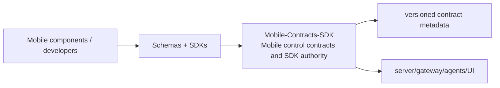
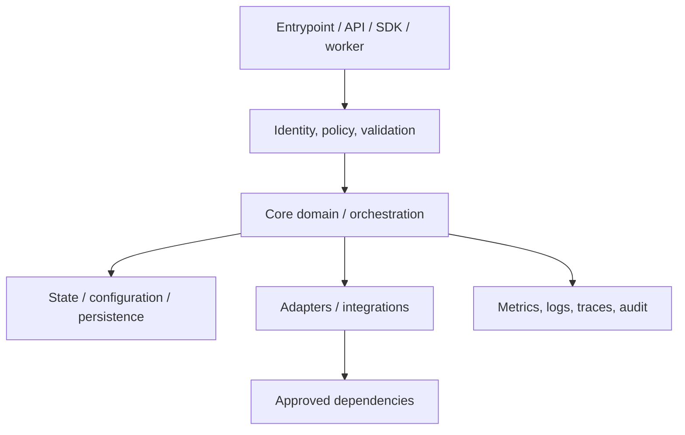
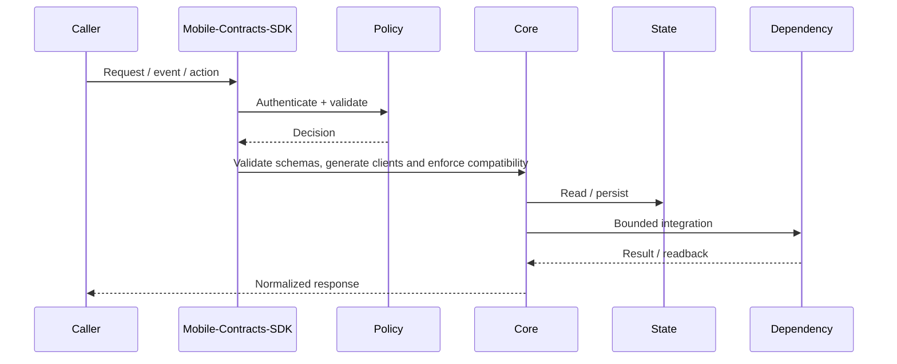
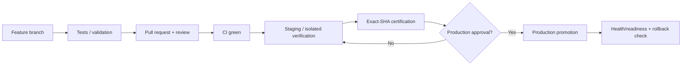
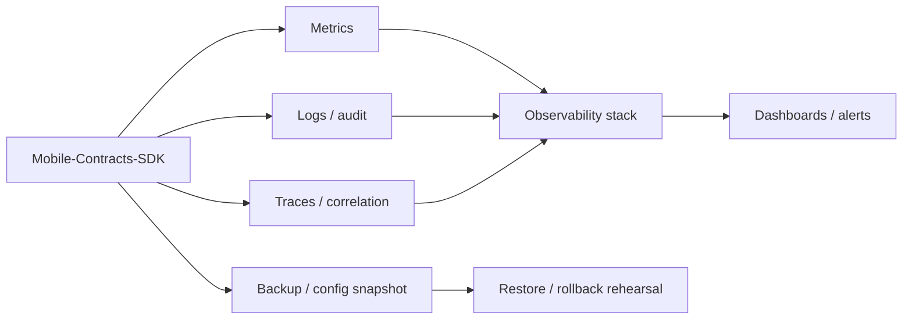

# Mobile-Contracts-SDK — Architecture Charts

> Repository: `appolon1908/Mobile-Contracts-SDK`  
> Baseline branch: `main`  
> Repository-local visual architecture. Update with code, contract and deployment changes.

## 1. System context

## 2. Internal component architecture

## 3. Critical flow

## 4. Deployment and promotion

## 5. Observability and recovery

## Ownership notes
- **Role:** Mobile control contracts and SDK authority
- **Primary boundary:** Schemas + SDKs
- **State/config:** versioned contract metadata
- **Dependencies/consumers:** server/gateway/agents/UI
- Cross-repository effects must use reviewed contracts; production effects remain separately gated.
